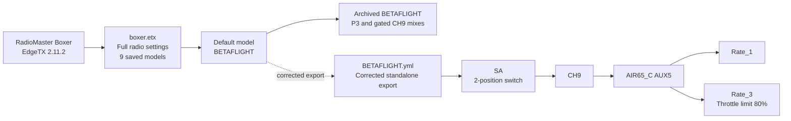

# RadioMaster Boxer overview

This folder keeps the Boxer's full EdgeTX settings backup, individual model exports, and a guide
to how the radio is configured. It is organized by radio so model files for other transmitters can
be added without mixing hardware-specific settings.

## Files in this folder

| File | Contents |
|---|---|
| [`boxer.etx`](boxer.etx) | Full EdgeTX Companion backup from `MODELS_BOXER`, captured 2026-10-14 at 11:08. Contains radio settings and nine models. This is the preserved source snapshot. |
| [`BETAFLIGHT.yml`](BETAFLIGHT.yml) | Corrected standalone export of the default `BETAFLIGHT` model. Its CH9 rate selector uses SA directly. |
| [`BETAFLIGHT.original-backup.yml`](BETAFLIGHT.original-backup.yml) | Untouched standalone `BETAFLIGHT` model from the original backup. Its CH9 setup is the earlier P3 / six-position arrangement. |

The `.etx` archive predates the standalone model correction. Its embedded `BETAFLIGHT` still has the
old CH9 mixer, so it is useful as an original full-radio snapshot but does not include the current
SA rate-selector edit. Save a fresh full `.etx` from the radio after confirming its current model
settings if you want a full-radio backup of the corrected setup.

## Radio settings in the backup

The archive is EdgeTX 2.11.2 format for a RadioMaster Boxer. The stored global radio settings show:

| Setting | Backup value |
|---|---|
| Internal RF module | CRSF |
| Stick mode | Mode 1 |
| P3 | Configured as a multiposition switch |
| SA | 2-position switch |
| SB, SC | 3-position switches |
| SD, SE | 2-position switches |
| SF | Toggle switch |

The backup contains calibration values for the sticks and pots. Personal registration data is not
reproduced in this overview.

## Models in the full backup

These are the nine model names stored in `boxer.etx`. The descriptions summarize their saved mixer
structure; names alone do not confirm which aircraft are currently assigned to them.

| Slot / file | Model | Mixer overview |
|---|---|---|
| 00 / `model00.yml` | `BOXER` | Basic template: four stick inputs and SA–SF across CH5–CH10. Its first four stick channels use a different order from the `BETAFLIGHT` model. |
| 01 / `model01.yml` | `BETAFLIGHT` | Default model selected in the backup. AETR stick channels, then switch-driven auxiliaries. In the archived copy CH9 still uses P3 with 6P20/6P21 conditions and has an empty-source row. |
| 02 / `model02.yml` | `DELTA` | Elevon-style mix: aileron and elevator inputs combine on CH1–CH2; throttle is CH3. |
| 03 / `model03.yml` | `HELI` | Helicopter-oriented setup with SD-switched throttle/collective mixes and SB on CH5. |
| 04 / `model04.yml` | `INAV` | AETR on CH1–CH4, with SE, SC, and SB on CH5–CH7. |
| 05 / `model05.yml` | `KOPILOT` | AETR on CH1–CH4, with SE and SC on CH5–CH6. |
| 06 / `model06.yml` | `ArduPilot` | AETR on CH1–CH4, with SE and SC on CH5–CH6. |
| 07 / `model07.yml` | `M1EVO` | More complex flying-wing mixer using logical-switch-gated stick mixes and throttle mixes. |
| 08 / `model08.yml` | `M1Evo-Sim` | Simulator variant with a similar logical-switch-driven mixer to `M1EVO`. |

## Default model and AIR65_C rate control

`BETAFLIGHT` is your default Boxer model. Its corrected standalone export sends SA to CH9. On the
AIR65_C, configured with the `AETR1234` channel map, CH9 is AUX5. You confirmed that SA switches
between Rate_1 and Rate_3; Rate_3 applies the 80% throttle limit. The radio backup's embedded copy
is the older version, as described above.

The archive and the standalone export are separate files. Importing `BETAFLIGHT.yml` updates that
model only; it does not rewrite `boxer.etx` or the other eight radio models.

## SD card scripts and tools

`SCRIPTS/` is a local copy of the folder you shared from
`C:\Users\irekr\OneDrive\Documents\Companion\Backup\MODELS_BOXER\SCRIPTS\`. It is stored
separately because it is not part of `boxer.etx`; the archive contains only `RADIO/radio.yml` and
the nine model files. The local copy is gitignored and will not be included in repository clones.

| Tool area | Files found | What that establishes |
|---|---|---|
| ExpressLRS | `TOOLS/elrsV3.lua` and `TOOLS/elrsV3.luac` | The local SD card backup includes the ExpressLRS Lua tool. Its name indicates the v3 tool generation; it does not reveal the transmitter module's installed firmware version or current live settings. |
| TBS Agent Lite | `TOOLS/TBSAgentLite.lua`, `.luac`, and its `LIB` / `SETUP` files | TBS Agent Lite support files are present. |
| EdgeTX tools | `TOOLS/WizardLoader.lua` and `.luac`; game tools for Asteroids, Breakout, Pong, Simulator, Snake, and X-Tris | The radio's tool menu has additional setup and game scripts in this SD card copy. |
| Model wizards | `WIZARD/delta.lua`, `heli.lua`, `multi.lua`, `plane.lua`, and `wizard.lua` | Setup wizard scripts are included for those model types. |
| Telemetry | `TELEMETRY/gplusl.lua` | A telemetry display script is included. |

The `.etx` model configuration selects CRSF for its internal RF module, and the SD card includes
the ExpressLRS tool. Those files are consistent with an ExpressLRS setup, but the tool reads
firmware and link settings from the connected module at runtime; they are not recorded as values in
this SD card backup. The live Lua screen is needed to confirm firmware version, packet rate, power,
telemetry ratio, and other module options. ExpressLRS documents the script location and runtime
fields in its [Lua script guide](https://www.expresslrs.org/quick-start/transmitters/lua-howto/).

## Bench verification

1. In the Boxer channel monitor, confirm SA changes CH9 between its two outputs.
2. With the AIR65_C connected and disarmed, confirm the corresponding values appear on AUX5.
3. On the Betaflight PID Tuning page, confirm the two positions select Rate_1 and Rate_3.
4. Verify receiver failsafe behavior with the props removed or motors otherwise made safe. The
   saved CRSF configuration does not establish what the receiver will do on signal loss.
