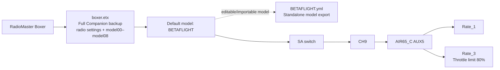

# RadioMaster Boxer models

`boxer.etx` is the full EdgeTX Companion settings backup copied unchanged from the user's MODELS_BOXER folder (archive timestamp 2026-10-14 11:08). It contains RADIO settings and models `model00` through `model08`. Keep this as the full-radio rollback snapshot; the standalone `BETAFLIGHT.yml` below is the edited single-model export and is not included in that archive.

`BETAFLIGHT.original-backup.yml` is an untouched copy of the user's EdgeTX
2.11.2 model backup. `BETAFLIGHT.yml` is the corrected version based on that
backup. Its CH9 mixer uses the Boxer `SA` switch directly. In the AIR65_C
Betaflight channel map (`AETR1234`), CH9 is AUX5. The pilot confirmed SA
switches between Rate_1 and Rate_3; Rate_3 applies the 80% throttle limit.

The previous CH9 setup used P3 gated by two six-position switch conditions and
had no third active selection. The revised CH9 setup removes those conditions;
CH5–CH8 and the rest of the model are retained from the backup.

`BETAFLIGHT` is the user's default Boxer model. The diagram shows how the full
radio backup and standalone model file relate to the AIR65_C rate selection:

The diagram reflects the user's confirmed behavior: SA selects Rate_1 and
Rate_3 on the AIR65_C. The two profile outcomes are shown without assigning
specific SA detents because the radio/receiver monitor values determine the
actual switch positions.

## Validate before flight

1. Import this model into EdgeTX Companion for the Boxer.
2. In the radio channel monitor, verify CH9 changes as SA is moved.
3. Connect the AIR65_C in Betaflight and confirm the Receiver tab's AUX5 value
   changes between the two intended selector values.
4. On PID Tuning, verify SA selects Rate_1 and Rate_3.

This model assumes SA is the intended rate control. If the intended physical
control is different, change the CH9 source to that control.
